<!-- Generated by scripts/build_catalog.py; edit data/ and i18n/. -->

# 🏆 أطلس إنجازات GitHub

دليل ميداني لشارات الملف الشخصي في GitHub: العامة والتاريخية والتجريبية والداخلية.

**آخر تحقق: 2026-09-30** · 14 إنجازًا · 7 علامات للملف الشخصي

[English](english.md) · [Русский](russian.md) · [Українська](ukrainian.md) · [العربية](arabic.md) · [简体中文](chinese.md) · [正體中文](traditional-chinese.md) · [Nederlands](dutch.md) · [Français](french.md) · [Deutsch](german.md) · [Ελληνικά](greek.md) · [हिन्दी](hindi.md) · [Bahasa Indonesia](indonesian.md) · [Italiano](italian.md) · [ಕನ್ನಡ](kannada.md) · [한국어](korean.md) · [ଓଡ଼ିଆ](odia.md) · [Naijá](pidgin.md) · [Polski](polish.md) · [Português](portuguese.md) · [Español](spanish.md) · [Kiswahili](swahili.md) · [தமிழ்](tamil.md) · [తెలుగు](telugu.md) · [Türkçe](turkish.md) · [Tiếng Việt](vietnamese.md) · [isiZulu](zulu.md)

> يغطي هذا الفهرس الشارات الموثقة علنًا. لا يمكن التحقق بشكل شامل من التجارب الداخلية غير المعلنة.

## 🧭 استكشف

[قابلة للحصول](#active) · [متوقفة](#retired) · [تجريبية / معطّلة](#experimental) · [جوائز GitHub الداخلية](#internal) · [المستويات](#tiers) · [الأشكال البصرية](#variants) · [علامات الملف الشخصي](#highlights) · [التاريخ والأدلة](#history) · [المصادر](#sources)

| الحالة | # |
| --- | ---: |
| 🟢 [قابلة للحصول](#active) | 7 |
| 🕰️ [متوقفة](#retired) | 2 |
| 🧪 [تجريبية / معطّلة](#experimental) | 2 |
| 🔒 [جوائز GitHub الداخلية](#internal) | 3 |

> أبلغت GitHub في 2026-09-23 عن تأخير في منح الشارات وعرضها؛ غياب الشارة لا يثبت أنها توقفت. [S08](https://github.com/orgs/community/discussions/203416)

## 🟢 قابلة للحصول

الحدود المذكورة مرصودة من قبل المجتمع؛ لا تنشر GitHub مواصفات كاملة لشروط الأهلية. قد يُحتسب النشاط الخاص عند تفعيله.

### Starstruck

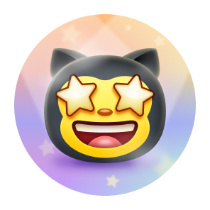

أنشئ مستودعًا يصل إلى **16 نجمة**. تعتمد المستويات الأعلى على عدد نجوم ذلك المستودع.

**المستويات:** 16 → 128 → 512 → 4096 (نجوم المستودع).

[مثال حي](https://github.com/torvalds?achievement=starstruck&tab=achievements) · [S21](https://github.com/torvalds?achievement=starstruck&tab=achievements) · [S03](https://github.blog/news-insights/product-news/introducing-achievements-recognizing-the-many-stages-of-a-developers-coding-journey/) · [S15](https://github.com/Schweinepriester/github-profile-achievements)

### Pull Shark

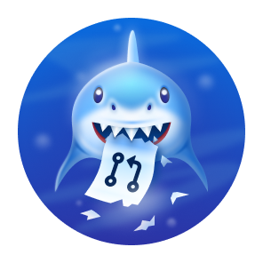

افتح **طلبَي سحب (2 pull requests)** يتم دمجهما. يُحتسب عدد طلبات السحب المدمجة التي فتحتها.

**المستويات:** 2 → 16 → 128 → 1024 (طلبات سحب مدمجة من تأليفك).

[مثال حي](https://github.com/ljharb?achievement=pull-shark&tab=achievements) · [S22](https://github.com/ljharb?achievement=pull-shark&tab=achievements) · [S03](https://github.blog/news-insights/product-news/introducing-achievements-recognizing-the-many-stages-of-a-developers-coding-journey/) · [S15](https://github.com/Schweinepriester/github-profile-achievements)

### Pair Extraordinaire

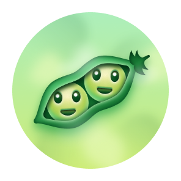

شارك في تأليف commits ضمن **طلب سحب واحد مدمج**؛ استخدم سطر `Co-authored-by` بإسناد صحيح.

**المستويات:** 1 → 10 → 24 → 48 (طلبات سحب مدمجة شاركت في تأليفها).

[مثال حي](https://github.com/Rongronggg9?achievement=pair-extraordinaire&tab=achievements) · [S23](https://github.com/Rongronggg9?achievement=pair-extraordinaire&tab=achievements) · [S18](https://docs.github.com/en/pull-requests/committing-changes-to-your-project/creating-and-editing-commits/creating-a-commit-with-multiple-authors) · [S15](https://github.com/Schweinepriester/github-profile-achievements)

### Galaxy Brain

احصل على **إجابتين مقبولتين** في GitHub Discussions. أُوقف منح الشارة في `github.com/orgs/community` منذ 2024-02-06.

**المستويات:** 2 → 8 → 16 → 32 (إجابات مقبولة).

[مثال حي](https://github.com/ljharb?achievement=galaxy-brain&tab=achievements) · [S24](https://github.com/ljharb?achievement=galaxy-brain&tab=achievements) · [S06](https://github.com/orgs/community/discussions/106536) · [S03](https://github.blog/news-insights/product-news/introducing-achievements-recognizing-the-many-stages-of-a-developers-coding-journey/) · [S15](https://github.com/Schweinepriester/github-profile-achievements)

### Quickdraw

أغلق issue أو طلب سحب **خلال 5 دقائق** من فتحه.

[مثال حي](https://github.com/Schweinepriester?achievement=quickdraw&tab=achievements) · [S25](https://github.com/Schweinepriester?achievement=quickdraw&tab=achievements) · [S03](https://github.blog/news-insights/product-news/introducing-achievements-recognizing-the-many-stages-of-a-developers-coding-journey/) · [S15](https://github.com/Schweinepriester/github-profile-achievements)

### YOLO

ادمج طلب السحب الخاص بك **دون مراجعة للكود**. شروط الأهلية التفصيلية غير محددة رسميًا.

[مثال حي](https://github.com/Schweinepriester?achievement=yolo&tab=achievements) · [S26](https://github.com/Schweinepriester?achievement=yolo&tab=achievements) · [S03](https://github.blog/news-insights/product-news/introducing-achievements-recognizing-the-many-stages-of-a-developers-coding-journey/) · [S15](https://github.com/Schweinepriester/github-profile-achievements)

### Public Sponsor


ادعم علنًا مشرفًا أو منظمة مؤهلة عبر **GitHub Sponsors**.

[مثال حي](https://github.com/ljharb?achievement=public-sponsor&tab=achievements) · [S27](https://github.com/ljharb?achievement=public-sponsor&tab=achievements) · [S19](https://github.com/sponsors) · [S02](https://github.blog/news-insights/company-news/open-source-goes-to-mars/)

## 🕰️ متوقفة

انتهت هذه الفعاليات. قد تبقى الجوائز الممنوحة سابقًا ظاهرة، لكن المساهمات الجديدة لا تفتحها.

### Arctic Code Vault Contributor

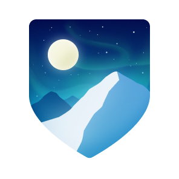

ساهم في مستودع مؤهل مشمول في **لقطة Arctic Code Vault بتاريخ 2020-02-02**. اللقطة مغلقة.

[مثال حي](https://github.com/JakubOleksy?achievement=arctic-code-vault-contributor&tab=achievements) · [S04](https://github.blog/open-source/maintainers/the-arctic-code-vault-starts-production-and-your-open-source-projects-are-being-archived/) · [S05](https://archiveprogram.github.com/)

### Mars 2020 Contributor

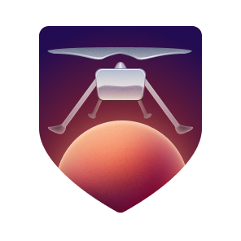

اكتب commit مشمولًا في إحدى إصدارات المشاريع المحددة التي استخدمتها **مروحية Ingenuity التابعة لـ NASA/JPL**. انتهت الفعالية.

[مثال حي](https://github.com/torvalds?achievement=mars-2020-contributor&tab=achievements) · [S01](https://docs.github.com/en/account-and-profile/reference/profile-reference) · [S02](https://github.blog/news-insights/company-news/open-source-goes-to-mars/)

## 🧪 تجريبية / معطّلة

أكدت GitHub أن ظهورها مجددًا في مارس 2026 كان عن طريق الخطأ؛ لم يُعلن أي موعد لإطلاقها للعامة.

### Heart On Your Sleeve

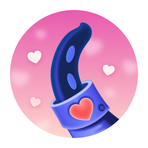

ارتباط تجريبي: تفاعلات ❤️. أزالت GitHub الإطلاق الخاطئ في مارس 2026؛ التفاعل اليوم ليس طريقة مؤكدة لفتح الشارة.

[S07](https://github.com/orgs/community/discussions/190746) · [S15](https://github.com/Schweinepriester/github-profile-achievements)

### Open Sourcerer

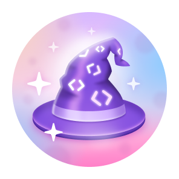

ارتباط تجريبي: طلبات سحب مدمجة عبر مستودعات عامة. طريقة الاحتساب الدقيقة وشروط الأهلية غير محددة علنًا.

[S07](https://github.com/orgs/community/discussions/190746) · [S15](https://github.com/Schweinepriester/github-profile-achievements)

## 🔒 جوائز GitHub الداخلية

تعكس هذه الجوائز مراحل داخلية في مشروع Proxima؛ لا توجد طريقة عامة للحصول عليها ولا تاريخ مؤكد لإيقافها.

### Proxima Pioneer

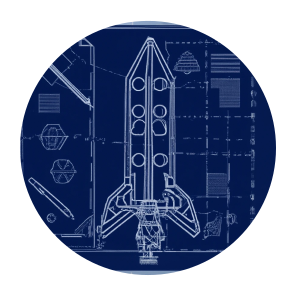

**مشارك M0** — ساهم في **إثبات المفهوم (POC) لمشروع Proxima**. رُصدت لدى @JakubOleksy.

[مثال حي](https://github.com/JakubOleksy?achievement=proxima-pioneer&tab=achievements) · [S10](https://github.com/JakubOleksy?achievement=proxima-pioneer&tab=achievements)

### Proxima Staffshipper

**مشارك M8** — أطلق **نسخة Proxima Staffship**. رُصدت لدى @JakubOleksy.

[مثال حي](https://github.com/JakubOleksy?achievement=proxima-staffshipper&tab=achievements) · [S11](https://github.com/JakubOleksy?achievement=proxima-staffshipper&tab=achievements)

### Proxima Staffuser

مشاركة الفريق — **انضم إلى Proxima**. رُصدت لدى @timrogers؛ وهي ثالث جائزة Proxima معروفة.

[مثال حي](https://github.com/timrogers?achievement=proxima-staffuser&tab=achievements) · [S12](https://github.com/timrogers?achievement=proxima-staffuser&tab=achievements)

## 🥇 المستويات

الافتراضي ← البرونزي ← الفضي ← الذهبي. x2/x3/x4 تسميات للمستويات وليست مضاعفات حسابية. منذ 2026-09-11 تعرض الملفات الشخصية أعلى مستوى.

| الإنجاز | النشاط المحتسب | الافتراضي | 🥉 x2 | 🥈 x3 | 🥇 x4 |
| --- | --- | ---: | ---: | ---: | ---: |
| [Starstruck](#starstruck) | نجوم المستودع | 16 | 128 | 512 | 4096 |
| [Pull Shark](#pull-shark) | طلبات سحب مدمجة من تأليفك | 2 | 16 | 128 | 1024 |
| [Pair Extraordinaire](#pair-extraordinaire) | طلبات سحب مدمجة شاركت في تأليفها | 1 | 10 | 24 | 48 |
| [Galaxy Brain](#galaxy-brain) | إجابات مقبولة | 2 | 8 | 16 | 32 |

معرض الشارات

| الإنجاز | الافتراضي | 🥉 x2 | 🥈 x3 | 🥇 x4 |
| --- | :---: | :---: | :---: | :---: |
| Starstruck |  | 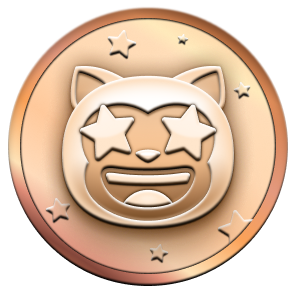 | 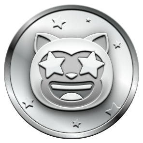 | 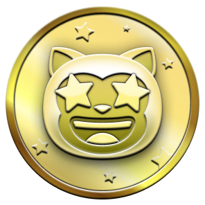 |
| Pull Shark |  | 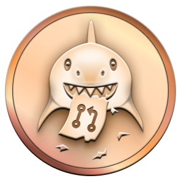 | 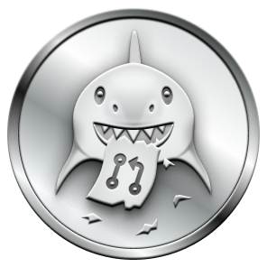 | 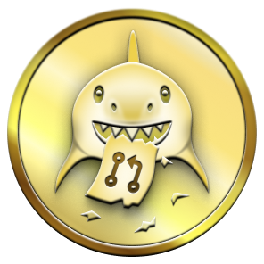 |
| Pair Extraordinaire |  | 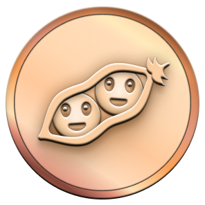 | 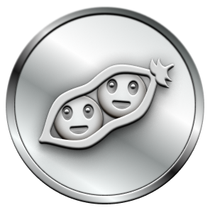 | 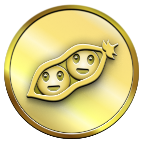 |
| Galaxy Brain |  | 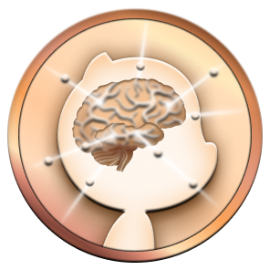 |  | 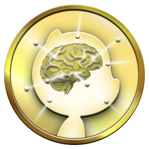 |
| Heart On Your Sleeve |  | 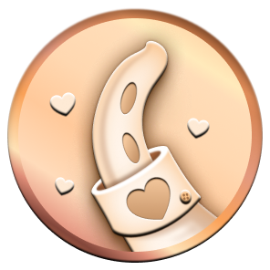 | 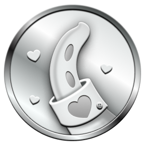 | 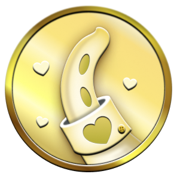 |
| Open Sourcerer |  | 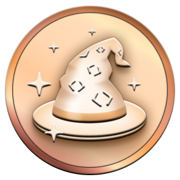 | 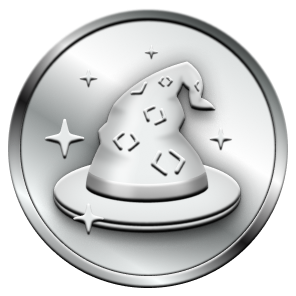 | 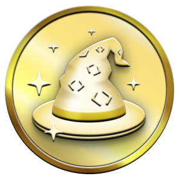 |

توجد تصاميم تجريبية. الحدود التالية تقارير مؤقتة من المجتمع، وليست قواعد عامة مؤكدة للحصول على الشارات.

| الإنجاز | الافتراضي | 🥉 x2 | 🥈 x3 | 🥇 x4 |
| --- | ---: | ---: | ---: | ---: |
| Heart On Your Sleeve | غير مؤكد | 16 | 128 | غير مؤكد |
| Open Sourcerer | غير مؤكد | 8 | 16 | 64 |

[S15](https://github.com/Schweinepriester/github-profile-achievements)

## 🎨 الأشكال البصرية

تصاميم لون البشرة لشارتي Starstruck وQuickdraw تغيّر المظهر فقط، لا الأهلية ولا عدد الإنجازات.

[إعدادات المظهر](https://github.com/settings/appearance)

| الإنجاز | 👋 | 👋🏻 | 👋🏼 | 👋🏽 | 👋🏾 | 👋🏿 |
| --- | :---: | :---: | :---: | :---: | :---: | :---: |
| Starstruck |  | 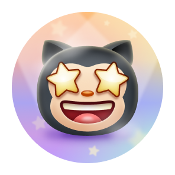 | 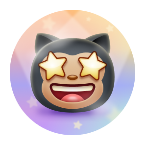 | 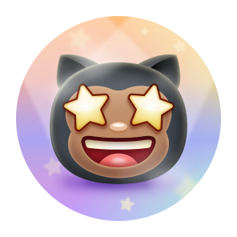 | 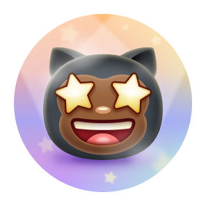 | 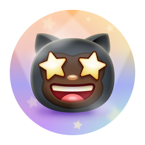 |
| Quickdraw |  | 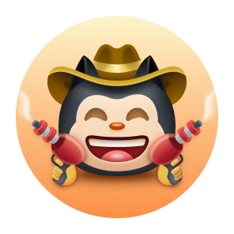 | 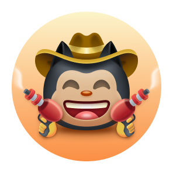 | 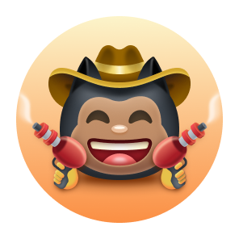 | 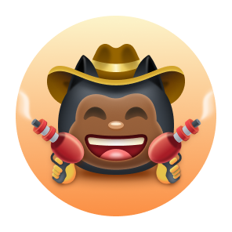 | 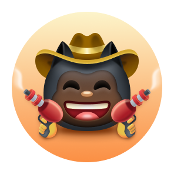 |

## ✨ علامات الملف الشخصي

العلامات هي تسميات للبرامج أو الحسابات، وتختلف عن ميداليات الإنجازات. يتبع توفرها البرنامج المعني.

| الاسم | الحالة | الشرط | المصادر |
| --- | --- | --- | --- |
| **Pro** | قابلة للحصول | استخدم GitHub Pro. | [S01](https://docs.github.com/en/account-and-profile/reference/profile-reference) |
| **Developer Program Member** | قابلة للحصول | انضم إلى GitHub Developer Program وأنشئ تطبيقًا يستخدم GitHub API. | [S01](https://docs.github.com/en/account-and-profile/reference/profile-reference) |
| **Security Bug Bounty Hunter** | قابلة للحصول | أبلغ عن ثغرات أمنية مؤهلة في GitHub عبر برنامج المكافآت. | [S01](https://docs.github.com/en/account-and-profile/reference/profile-reference) · [S20](https://bounty.github.com/) |
| **GitHub Campus Expert** | قابلة للحصول | شارك في برنامج GitHub Campus Experts؛ راجع قواعد التقديم الحالية. | [S01](https://docs.github.com/en/account-and-profile/reference/profile-reference) |
| **Security Advisory Credit** | قابلة للحصول | احصل على إسناد مقبول في استشارة أمنية ضمن GitHub Advisory Database. | [S01](https://docs.github.com/en/account-and-profile/reference/profile-reference) |
| **GitHub Star** | قابلة للحصول | يتم اختيارك في برنامج GitHub Stars؛ هذا ليس إنجازًا مرتبطًا بعدد نجوم المستودع. | [S16](https://stars.github.com/) |
| **Discussion answered** | متوقفة | علامة تاريخية للإجابات المقبولة في Discussions؛ أُفيد في 2022 بأن Galaxy Brain حلّت محلها. | [S14](https://github.com/orgs/community/discussions/31629) |

## 🗂️ التاريخ والأدلة

تعود التصاميم الأصلية الثلاثة إلى الفترة من 2021-04-19 حتى إعادة التصميم في 2022-06-09؛ الأسماء السابقة ليست إنجازات إضافية.

| التصميم | 2021–2022 | الاسم الحالي |
| :---: | --- | --- |
|  | Arctic Code Vault Contributor | Arctic Code Vault Contributor |
|  | GitHub Sponsor | Public Sponsor |
| 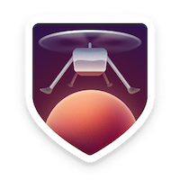 | Mars 2020 Helicopter Contributor | Mars 2020 Contributor |

[S02](https://github.blog/news-insights/company-news/open-source-goes-to-mars/) · [S03](https://github.blog/news-insights/product-news/introducing-achievements-recognizing-the-many-stages-of-a-developers-coding-journey/) · [S15](https://github.com/Schweinepriester/github-profile-achievements)

### حالة Proxima

تطابق لقطات الشاشة المقدمة بطاقات Proxima الحية. Pioneer: مساهمة في النموذج الأولي M0؛ Staffshipper: إطلاق نسخة M8؛ Staffuser: انضمام الفريق.

| الإنجاز | الحساب | UTC |
| --- | --- | --- |
| [Proxima Pioneer](https://github.com/JakubOleksy?achievement=proxima-pioneer&tab=achievements) | @JakubOleksy | 2023-06-01T17:34:35Z |
| [Proxima Staffshipper](https://github.com/JakubOleksy?achievement=proxima-staffshipper&tab=achievements) | @JakubOleksy | 2024-08-21T22:28:27Z |
| [Proxima Staffuser](https://github.com/timrogers?achievement=proxima-staffuser&tab=achievements) | @timrogers | 2023-08-16T18:28:07Z |

تعني «inaccessible» أن الحدث الأصلي خاص ولا يظهر للزوار. تاريخ Staffshipper في لقطة الشاشة هو 2024-08-22، لكنه 2024-08-21 بتوقيت UTC.

[البحث التفصيلي (EN / RU)](../docs/research.en.md)

لقطات الشاشة الأصلية

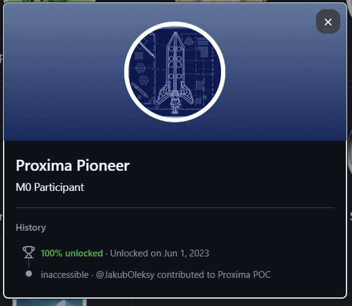

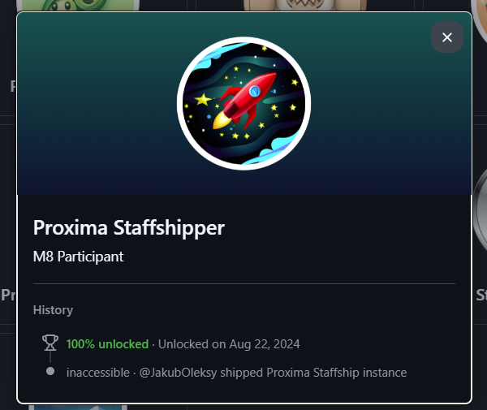

## 🔎 المصادر

الإعلانات الرسمية تحدد الحالة؛ بطاقات الملف الشخصي تثبت الأحداث الممنوحة؛ حدود المجتمع تبقى ملاحظات.

- **S01** — [Profile reference](https://docs.github.com/en/account-and-profile/reference/profile-reference) · مصدر رسمي
- **S02** — [Open source goes to Mars (2021-04-19)](https://github.blog/news-insights/company-news/open-source-goes-to-mars/) · مصدر رسمي
- **S03** — [Introducing Achievements (2022-06-09)](https://github.blog/news-insights/product-news/introducing-achievements-recognizing-the-many-stages-of-a-developers-coding-journey/) · مصدر رسمي
- **S04** — [Arctic Code Vault snapshot (2020-02-02)](https://github.blog/open-source/maintainers/the-arctic-code-vault-starts-production-and-your-open-source-projects-are-being-archived/) · مصدر رسمي
- **S05** — [GitHub Archive Program](https://archiveprogram.github.com/) · مصدر رسمي
- **S06** — [Achievements disabled in GitHub Community (2024-02-06)](https://github.com/orgs/community/discussions/106536) · مصدر رسمي
- **S07** — [Experimental achievements enabled in error (2026-03-27)](https://github.com/orgs/community/discussions/190746) · مصدر رسمي
- **S08** — [Profile rendering incident; staff update 2026-09-23](https://github.com/orgs/community/discussions/203416) · مصدر رسمي
- **S09** — [Profiles now show the highest achievement tier (2026-09-11)](https://github.blog/changelog/2026-09-11-profiles-now-show-your-highest-achievement-badge-tier/) · مصدر رسمي
- **S10** — [JakubOleksy — Proxima Pioneer](https://github.com/JakubOleksy?achievement=proxima-pioneer&tab=achievements) · ملف شخصي مرصود
- **S11** — [JakubOleksy — Proxima Staffshipper](https://github.com/JakubOleksy?achievement=proxima-staffshipper&tab=achievements) · ملف شخصي مرصود
- **S12** — [timrogers — Proxima Staffuser](https://github.com/timrogers?achievement=proxima-staffuser&tab=achievements) · ملف شخصي مرصود
- **S13** — [GitHub Enterprise Cloud with data residency](https://github.blog/engineering/engineering-principles/github-enterprise-cloud-with-data-residency/) · مصدر رسمي
- **S14** — [Discussion answered highlight replaced; support reported by a user](https://github.com/orgs/community/discussions/31629) · تقرير من المجتمع
- **S15** — [Schweinepriester — catalogue, experiments and historical artwork](https://github.com/Schweinepriester/github-profile-achievements) · تقرير من المجتمع
- **S16** — [GitHub Stars](https://stars.github.com/) · مصدر رسمي
- **S17** — [Manage achievement visibility](https://docs.github.com/en/account-and-profile/how-tos/contribution-settings/manage-visibility-settings-for-private-contributions-and-achievements) · مصدر رسمي
- **S18** — [Create a commit with multiple authors](https://docs.github.com/en/pull-requests/committing-changes-to-your-project/creating-and-editing-commits/creating-a-commit-with-multiple-authors) · مصدر رسمي
- **S19** — [GitHub Sponsors](https://github.com/sponsors) · مصدر رسمي
- **S20** — [GitHub Bug Bounty](https://bounty.github.com/) · مصدر رسمي
- **S21** — [torvalds — Starstruck awarded card](https://github.com/torvalds?achievement=starstruck&tab=achievements) · ملف شخصي مرصود
- **S22** — [ljharb — Pull Shark awarded card](https://github.com/ljharb?achievement=pull-shark&tab=achievements) · ملف شخصي مرصود
- **S23** — [Rongronggg9 — Pair Extraordinaire awarded card](https://github.com/Rongronggg9?achievement=pair-extraordinaire&tab=achievements) · ملف شخصي مرصود
- **S24** — [ljharb — Galaxy Brain awarded card](https://github.com/ljharb?achievement=galaxy-brain&tab=achievements) · ملف شخصي مرصود
- **S25** — [Schweinepriester — Quickdraw awarded card](https://github.com/Schweinepriester?achievement=quickdraw&tab=achievements) · ملف شخصي مرصود
- **S26** — [Schweinepriester — YOLO awarded card](https://github.com/Schweinepriester?achievement=yolo&tab=achievements) · ملف شخصي مرصود
- **S27** — [ljharb — Public Sponsor awarded card](https://github.com/ljharb?achievement=public-sponsor&tab=achievements) · ملف شخصي مرصود

[الرئيسية](../README.md) · [المساهمة](../CONTRIBUTING.md)

